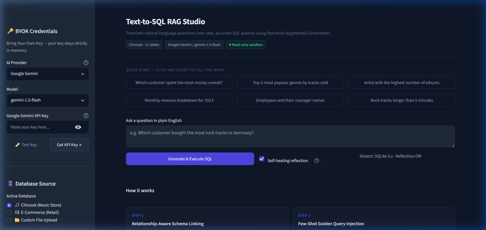
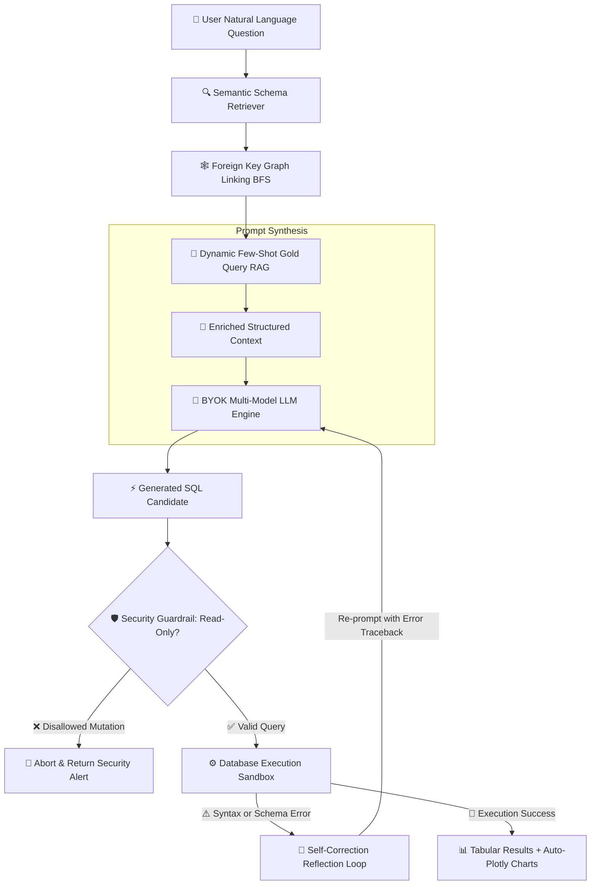

<div align="center">

# ⚡ Text-to-SQL RAG Studio
### Enterprise-Grade Natural Language to SQL with Advanced RAG, Schema Graph Linking & Self-Correction

[](https://python.org)
[](https://streamlit.io)
[](https://langchain.com)
[](LICENSE)
[](CONTRIBUTING.md)

<br />

<p align="center">
  
</p>

*Transform complex natural language questions into accurate, production-ready SQL queries using an Advanced Retrieval-Augmented Generation (RAG) pipeline with Schema Graph Linking, Dynamic Few-Shot learning, and Agentic Self-Healing.*

---

[Key Features](#-key-features) • [Architecture](#-architecture--pipeline) • [Supported Providers](#-byok-supported-providers) • [Quickstart](#-quickstart) • [Sample Datasets](#-included-sample-datasets) • [License](#-license)

</div>

<br />

## 🌟 Key Features

### 🔑 Bring Your Own Key (BYOK)
- Connect any leading AI provider in real-time: **Google Gemini**, **OpenAI**, **Anthropic Claude**, **Groq (Llama 3)**, or **OpenRouter/Custom LLMs**.
- **Zero hardcoded credentials:** API keys stay strictly in session memory and are never persisted or logged.
- Real-time connection testing with one-click verification feedback.

### 🧠 Advanced RAG with Schema Graph Linking
Standard Text-to-SQL systems often hallucinate column names or fail when a query requires intermediate bridge tables. Text-to-SQL RAG Studio solves this with a multi-stage retrieval architecture:
- **Semantic Candidate Filtering:** Matches the user's intent against indexed database tables and column definitions.
- **Foreign-Key Graph Pathfinding (BFS):** Automatically traverses the schema relational graph to discover and inject intermediate join tables (e.g., linking `Customer` to `Track` via `Invoice` and `InvoiceLine`), preventing broken or disconnected `JOIN` queries.
- **Dynamic Few-Shot Gold Query Retrieval:** Indexes verified domain-specific `(Question, SQL)` pairs and injects the top-K relevant examples into context to guide complex dialect syntax.

### 🛡️ Agentic Self-Correction & SQL Healing
- Executes generated queries inside a sandboxed transaction environment.
- If an execution fails (e.g., unknown column, syntax error, grouping mismatch), an autonomous reflection loop captures the database error traceback, correlates it with the schema, and repairs the SQL query in real-time (up to 3 attempts).

### 🔒 Enterprise Security Guardrails
- **Strict Read-Only Enforcement:** Only `SELECT` and `WITH` (CTE) statements are permitted.
- Destructive commands (`DROP`, `DELETE`, `UPDATE`, `ALTER`, `TRUNCATE`, `INSERT`, etc.) are intercepted and blocked prior to database execution.

### 📊 Automated Visual Analytics
- Instant interactive data table preview with column sorting and search.
- **One-Click CSV Export** for downstream reporting and spreadsheets.
- **Automatic Plotly Chart Synthesis:** Dynamically identifies categorical, numerical, and temporal dimensions to generate responsive bar charts, line trends, or scatter plots without manual configuration.

---

## 🏗️ Architecture & Pipeline



---

## 🤖 BYOK Supported Providers

| Provider | Recommended Models | Strengths |
| :--- | :--- | :--- |
| **Google Gemini** | `gemini-1.5-pro`, `gemini-1.5-flash` | Ultra-long schema context, high reasoning fidelity |
| **OpenAI** | `gpt-4o`, `gpt-4o-mini`, `gpt-4-turbo` | Industry benchmark for precise SQL dialect generation |
| **Anthropic** | `claude-3-5-sonnet-20241022`, `claude-3-haiku` | Exceptional reasoning on complex nested subqueries & CTEs |
| **Groq** | `llama-3.1-70b-versatile`, `llama-3.1-8b-instant` | Near-instant sub-second SQL inference speed |
| **Custom / OpenRouter** | Any OpenAI-compatible endpoint | Flexibility for local models (vLLM, Ollama, LM Studio) |

---

## 📂 Project Structure

```
text-to-sql-rag/
├── .streamlit/
│   └── config.toml          # Native dark theme styling & typography tokens
├── assets/
│   └── preview.png          # High-resolution application preview screenshot
├── core/
│   ├── __init__.py          # Module initialization
│   ├── db_manager.py        # Schema introspection, FK graph search, safe execution
│   ├── llm_factory.py       # BYOK multi-provider LLM initialization & key testing
│   ├── rag_retriever.py     # Schema table retriever + Few-shot gold query retriever
│   └── sql_generator.py     # Prompt synthesis, self-correction loop, auto-charting
├── data/
│   ├── setup_sample_db.py   # Seeding script for sample SQLite databases
│   ├── chinook.db           # 11-table relational music store database
│   └── ecommerce.db         # 5-table e-commerce / retail database
├── app.py                   # Main interactive Streamlit web application
├── requirements.txt         # Production dependencies
├── .gitignore               # Ignores virtualenvs, caches, and secrets
└── README.md                # Project documentation
```

---

## 🚀 Quickstart

### 1. Clone the Repository
```bash
git clone https://github.com/parv55555/text-to-sql-rag.git
cd text-to-sql-rag
```

### 2. Set Up a Virtual Environment
```bash
# macOS/Linux
python3 -m venv venv
source venv/bin/activate

# Windows (PowerShell)
python -m venv venv
.\venv\Scripts\Activate.ps1
```

### 3. Install Dependencies
```bash
pip install -r requirements.txt
```

### 4. Run the Application
```bash
streamlit run app.py
```

The web studio will launch automatically at `http://localhost:8501`.

---

## 🗄️ Included Sample Datasets

Out of the box, the studio includes two relational databases for immediate exploration:

1. **Chinook Digital Media Store (`chinook.db`)**:
   - 11 interconnected relational tables: `Artist`, `Album`, `Track`, `Genre`, `MediaType`, `Invoice`, `InvoiceLine`, `Customer`, `Employee`, `Playlist`, `PlaylistTrack`.
   - Ideal for testing multi-table `JOIN` statements and hierarchical aggregation.

2. **Retail E-Commerce (`ecommerce.db`)**:
   - 5 tables: `customers`, `orders`, `order_items`, `products`, `categories`.
   - Perfect for testing sales metrics, customer segmentation, and product performance analysis.

3. **Bring Your Own Data**:
   - Upload any custom SQLite `.db` or tabular `.csv` file directly from the sidebar.

---

## 💡 Example Queries to Try

- *"Who are the top 5 customers by total invoice spending and where are they from?"*
- *"Show total revenue generated per music genre ordered from highest to lowest."*
- *"Find all orders placed in the last 6 months along with customer names and total quantity."*
- *"Which artists have released more than 5 albums?"*

---

## 🌐 Deploy to Streamlit Community Cloud

Deploying your own live instance takes under 1 minute:

1. Fork or push this repository to your GitHub account.
2. Sign in to [Streamlit Community Cloud](https://share.streamlit.io/).
3. Click **New app**, select your repository and branch (`main`), set Main file path to `app.py`.
4. Click **Deploy**!

---

## 🤝 Contributing

Contributions, bug reports, and feature requests are welcome!
Feel free to open an issue or submit a Pull Request.

1. Fork the Project
2. Create your Feature Branch (`git checkout -b feature/AmazingFeature`)
3. Commit your Changes (`git commit -m 'Add some AmazingFeature'`)
4. Push to the Branch (`git push origin feature/AmazingFeature`)
5. Open a Pull Request

---

## 📄 License

Distributed under the **MIT License**. See `LICENSE` for more information.

<div align="center">
  <sub>Built with ❤️ using Streamlit, LangChain, and Advanced RAG.</sub>
</div>
